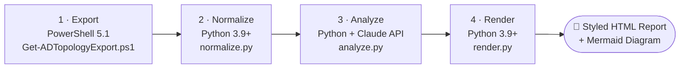

# PowerShell Scripts — Active Directory & Hybrid Identity

[](https://github.com/Karanth1992/powershell-scripts/actions/workflows/pssa.yml)


[](LICENSE)

Standalone (non-module) PowerShell scripts for Active Directory administration, GPO inventory, DC health checks, Hybrid Identity (Entra Connect) auditing, and an end-to-end multi-language **AI Active Directory architecture documentation engine**.

Each standalone script runs independently without requiring module installation.

Detailed write-ups and walkthroughs are published at **[karanth.ovh](https://karanth.ovh)**.

Looking for the packaged module instead? See **[ADOpsKit](https://github.com/Karanth1992/ADOpsKit)** (published to the PowerShell Gallery) — it covers the same domain with a maintained, versioned function set. Server provisioning tooling lives in **[ADSetupKit](https://github.com/Karanth1992/ADSetupKit)**, and declarative lab IaC lives in **[ADLabProvisioner](https://github.com/Karanth1992/ADLabProvisioner)**.

---

## 🏗️ Repository Structure

```text
powershell-scripts/
├── ad-doc-generator/          → Multi-tier AI architecture doc engine (PowerShell + Python + Claude)
│   ├── export/                → PowerShell 5.1 topology & schema snapshot exporter
│   ├── normalize/             → Python graph normalizer ({nodes, edges} schema)
│   ├── analyze/               → Python + Claude LLM narrative & anomaly analyzer
│   ├── render/                → Python HTML report & Mermaid diagram generator
│   └── samples/               → Sanitized offline sample data & generated reports
└── standalone/
    ├── active-directory/
    │   ├── health/            → DC health, port tests, performance baselines, heartbeat
    │   ├── audit/             → LDAP security, account lockouts, stale computers, decommissioning
    │   ├── inventory/         → AD architecture assessment, GPO inventory, replication diagrams
    │   ├── provisioning/      → Bulk AD user account creation from CSV
    │   └── reference/         → PowerShell cheat sheet
    └── azure-ad/              → Entra Connect / Hybrid Identity sync status
```

---

## 🤖 Featured Engine: `ad-doc-generator`

[`ad-doc-generator/`](ad-doc-generator/) turns a live snapshot of an Active Directory environment into an executive architecture narrative, a risk/anomaly breakdown, and a Mermaid topology diagram — automatically from changing directory data.



- **Stage 1 (Export - PowerShell):** Read-only pull of OUs, trusts, DCs/sites, replication topology, GPO links, and key group memberships into a JSON snapshot.
- **Stage 2 (Normalize - Python):** Flattens the raw export into a decoupled `{nodes, edges}` graph representation.
- **Stage 3 (Analyze - Python + Claude API):** Analyzes the graph structure to generate an architectural summary and anomaly report. Supports an automated Anthropic API path or a manual prompt template path.
- **Stage 4 (Render - Python):** Merges the findings and generated Mermaid diagram into a responsive, self-contained HTML report.

Full pipeline documentation, data schemas, and execution workflows are detailed in **[`ad-doc-generator/README.md`](ad-doc-generator/README.md)** and **[`ad-doc-generator/WORKFLOW.md`](ad-doc-generator/WORKFLOW.md)**.

---

## 📜 Standalone Scripts

### active-directory/health

| Script | Purpose | Output |
|--------|---------|--------|
| [Get-ADForestHealth.ps1](standalone/active-directory/health/Get-ADForestHealth.ps1) | Forest-wide DC health report — DCDiag, disk, CPU, memory, uptime. | Color-coded HTML |
| [Test-DCPortHealth.ps1](standalone/active-directory/health/Test-DCPortHealth.ps1) | Tests critical AD TCP ports across all domain controllers. | Console table, CSV |
| [Enable-DCPerformanceBaseline.ps1](standalone/active-directory/health/Enable-DCPerformanceBaseline.ps1) | Deploys a `logman` performance Data Collector Set on each DC. | Binary perf logs on each DC |
| [Invoke-ADRealtimeHeartbeat-v1.1.ps1](standalone/active-directory/health/Invoke-ADRealtimeHeartbeat-v1.1.ps1) | Lightweight per-DC heartbeat (TCP ports, SYSVOL/NETLOGON, required services) for 30-60 second polling; alerts via email/Slack only on state change. | `latest.html` / `latest.json` + dated history |

### active-directory/audit

| Script | Purpose | Output |
|--------|---------|--------|
| [Get-InsecureLDAPBinds.ps1](standalone/active-directory/audit/Get-InsecureLDAPBinds.ps1) | Detects unsigned and simple LDAP binds via Event ID 2889. | Dated CSV |
| [Get-AccountLockoutReport.ps1](standalone/active-directory/audit/Get-AccountLockoutReport.ps1) | Reports locked accounts and traces lockout source via Event ID 4740. | TXT, CSV, HTML |
| [Get-DCDecommissionReadiness.ps1](standalone/active-directory/audit/Get-DCDecommissionReadiness.ps1) | Pre-decommission scan of a single DC — FSMO roles, replication health, logon activity, DNS/SYSVOL/DFSR, sites/subnets, trusts, Global Catalog status, and a readiness checklist. | Styled HTML |
| [Disable-StaleADComputer.ps1](standalone/active-directory/audit/Disable-StaleADComputer.ps1) | Discovers and safely disables inactive AD computer accounts with built-in DC and cluster object protection. Supports `-WhatIf`. | Console summary, CSV |

### active-directory/inventory

| Script | Purpose | Output |
|--------|---------|--------|
| [Get-ADArchitectureAssessment.ps1](standalone/active-directory/inventory/Get-ADArchitectureAssessment.ps1) | Broad AD inventory — domains, DCs, users, computers, OUs, sites, replication, GPOs, ports, services. | HTML, JSON, CSV |
| [Get-ADReplicationTopologyDiagram.ps1](standalone/active-directory/inventory/Get-ADReplicationTopologyDiagram.ps1) | AD replication topology diagram using LDAP + repadmin. No ADWS required. | Self-contained HTML |
| [Get-GPOInventory.ps1](standalone/active-directory/inventory/Get-GPOInventory.ps1) | GPO inventory with links, permissions, status, and WMI filters. | Styled HTML |
| [Get-GPOInventoryWithSettings-DC.ps1](standalone/active-directory/inventory/Get-GPOInventoryWithSettings-DC.ps1) | Extended GPO inventory including configured settings from `Get-GPOReport` XML. | Styled HTML |

### active-directory/provisioning

| Script | Purpose | Output |
|--------|---------|--------|
| [New-BulkADUser.ps1](standalone/active-directory/provisioning/New-BulkADUser.ps1) | Bulk-creates AD user accounts from CSV with per-row validation and auto-generated secure passwords. Supports `-WhatIf`. | Detailed console log |

### active-directory/reference

| File | Purpose |
|------|---------|
| [AD-PowerShell-Cheatsheet.md](standalone/active-directory/reference/AD-PowerShell-Cheatsheet.md) | Quick Active Directory PowerShell command reference. |

### azure-ad

| Script | Purpose | Output |
|--------|---------|--------|
| [Get-EntraConnectSyncStatus.ps1](standalone/azure-ad/Get-EntraConnectSyncStatus.ps1) | Entra Connect health check — sync cycle, connector errors, pending exports, password sync, staging mode. | Console summary, CSV |

---

## ⚙️ Requirements

- Windows PowerShell 5.1 or later.
- Active Directory PowerShell module (`RSAT-AD-PowerShell`).
- Group Policy module for GPO inventory scripts.
- ADSync module (installed with Entra Connect) for `azure-ad/` scripts.
- Python 3.9+ (standard library only for Stages 2 & 4 of `ad-doc-generator`).
- Administrative rights appropriate for the target environment.

---

## 🚀 Quick Start

```powershell
# Clone the repository
git clone https://github.com/Karanth1992/powershell-scripts.git
cd .\powershell-scripts

# Test DC port reachability
.\standalone\active-directory\health\Test-DCPortHealth.ps1 -TimeoutSeconds 5 -ExportPath "C:\temp\DCPortHealth.csv"

# Run AD Forest health diagnostic
.\standalone\active-directory\health\Get-ADForestHealth.ps1

# Generate AD Replication topology diagram
.\standalone\active-directory\inventory\Get-ADReplicationTopologyDiagram.ps1 -OutputPath "C:\temp\topology.html"

# Run ad-doc-generator topology snapshot export
.\ad-doc-generator\export\Get-ADTopologyExport.ps1 -Verbose
```

---

## 🛡️ Safety Notes

- Review each script before running in production.
- Test in a lab or pilot domain first.
- All Active Directory scripts are read-only unless explicitly noted.
- `Enable-DCPerformanceBaseline.ps1` creates a Data Collector Set on domain controllers.
- Modifying scripts (`New-BulkADUser.ps1`, `Disable-StaleADComputer.ps1`) support `-WhatIf` / `-Confirm`.
- Port checks are TCP reachability tests only — not a vulnerability scan.

---

## 🔧 Troubleshooting

| Symptom | Check |
|---------|-------|
| Module not found | Run as Administrator; `Install-WindowsFeature RSAT-AD-PowerShell` |
| Access denied on remote DCs | Confirm Domain Admin rights or equivalent delegated permissions |
| WMI failures | Ensure DCOM/WMI firewall exceptions are open; WinRM not required for WMI scripts |
| Empty output / no events | Increase `-Hours` or `-LookbackMilliseconds`; confirm audit policy logs the target event IDs |
| Entra Connect script fails | Must run locally on the Entra Connect server — remote execution (WinRM) is not supported |

---

## 🤝 Contributing & Security

- See [CONTRIBUTING.md](CONTRIBUTING.md) for coding standards, testing requirements, and the PR checklist.
- Security reports: See [SECURITY.md](SECURITY.md) — please do not open public issues for vulnerabilities.

---

## 👤 Author

**K Shankar R Karanth** — Active Directory & Hybrid Identity Engineer  
[karanth.ovh](https://karanth.ovh) · [LinkedIn](https://www.linkedin.com/in/karanth-shankar/)

---

## 📜 License

MIT — see [LICENSE](LICENSE).
